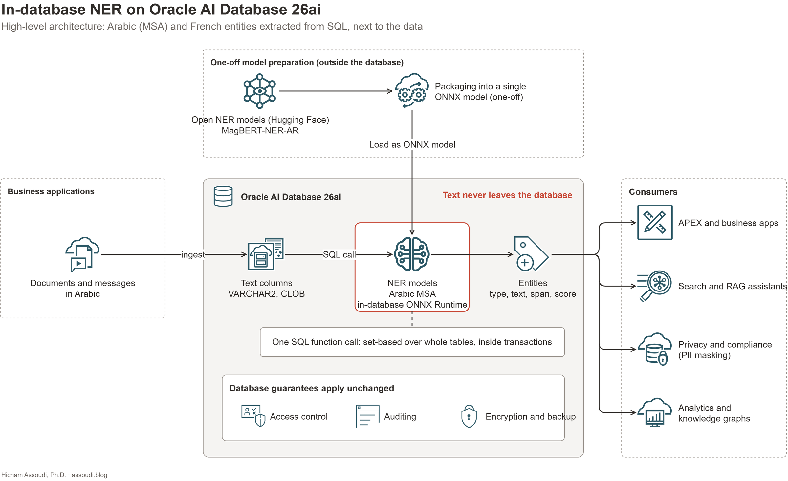
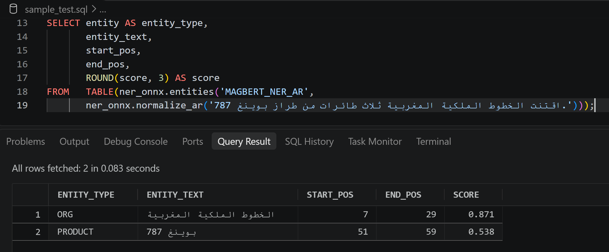

Oracle AI Database 26ai can run AI models right next to your data. Embeddings, classification, clustering, and regression all run inside the database, called from SQL.

One family of tasks is missing: the ones that need a prediction for **every word** rather than one answer for the whole text. Named Entity Recognition (NER) is the best-known example, and for many organizations it is the one they need most.

This article tells the story of that gap and how I closed it: the need, the limitation, the idea, the experiment, and the result. My own Arabic NER model now runs inside Oracle AI Database 26ai, on CPU, called from one SQL statement. I also compare the approach with what Oracle already offers for Arabic NER: OCI Language and the Private AI Services Container.

The approach is not specific to one model. It converts BERT-family NER models from Hugging Face (BERT, and RoBERTa-style models such as CamemBERT), and so far I have validated it in two languages: **Arabic and French**. This article uses Arabic for its examples.

## The need: text the database stores but cannot read

Enterprise databases hold more than structured records. They also hold reports, correspondence, complaints, incident descriptions, contracts, and news monitoring feeds. Applications can retrieve that text, but they cannot query what is *in* it.

Take an Oracle database holding thousands of Arabic documents. A business user asks a simple question: **which people, organizations, and places do these documents mention?**

Here is one sentence from such a table:

> التقى أحمد العلوي بممثلي بنك المغرب في الرباط.

The answer the user wants looks like this:

| Mention | Entity type |
| --- | --- |
| أحمد العلوي | Person |
| بنك المغرب | Organization |
| الرباط | Geopolitical location |

Once the entities are rows, every question about them becomes a SQL query: which documents name this bank, which people appear with that organization, which records mention a city.

## The problem: NER is a token-level task

Finding these mentions is not the same as classifying the sentence. A classifier returns one label for the whole text. An NER model returns a label for **every token**, and those labels then have to be stitched back into complete entities with exact boundaries in the original text.

That per-token output is exactly what Oracle's in-database AI does not provide.

## The tension: Oracle runs models, but not this kind

Oracle AI Database 26ai imports ONNX models as `MINING MODEL` objects and scores them through SQL operators. Oracle documents this for **classification, regression, clustering, and embeddings**. All four give **one result per row**.

The standard path to bring a Hugging Face model in is OML4Py. It converts the model to ONNX and adds the tokenization and post-processing that Oracle requires every in-database text model to include. The difference between its templates is the post-processing:

| OML4Py pipeline | Post-processing | Result per input text |
| --- | --- | --- |
| Text embedding | Mean pooling and normalization | One vector |
| Text classification | Softmax | One probability per label, scored with `PREDICTION` and `PREDICTION_PROBABILITY` |
| *Token-level NER* | *No template* | *One label per token is what NER needs* |

Both templates reduce a text to one result. **There is no OML4Py path for NER**, and no built-in operator returns entities, labels, and character offsets from a neural model.

So an Oracle team that needs Arabic NER today faces a tension. The text is in the database, the database can run AI models, but the extraction has to happen somewhere else:

- **OCI Language**, a managed cloud service: the text goes out to OCI.
- **An inference service of your own**, or Oracle's Private AI Services Container: another component to deploy, secure, and keep in sync.
- **Oracle Text `CTX_ENTITY`**: inside the database, but driven by dictionaries and rules, with built-in rules focused on English.

Each of these is a valid choice, and I compare them [below](#how-it-compares-with-oracles-options-for-arabic-ner). But none of them lets you run *your own* neural NER model inside the database, next to the data, from SQL.

## The idea

Oracle's model import checks the *form* of a model: what goes in and what comes out. If an NER model could be packaged so that its token-level predictions fit a form Oracle already accepts, and those predictions could be turned back into entities inside the database, then NER would need no external service at all.

That was the hypothesis. The experiment was designed to test it end to end.

## The experiment

### The model

I used [MagBERT-NER-AR](https://huggingface.co/TypicaAI/MagBERT-NER-AR), an Arabic NER model I developed through Typica.ai back in 2023.

It was **fine-tuned from an Arabic BERT backbone** on my own manually curated and annotated dataset, drawn from Moroccan Arabic-language news. It targets **Modern Standard Arabic**, with particular attention to the names, institutions, and places found in that corpus.

It recognizes **12 entity types**: people, organizations, geopolitical entities, other locations, nationalities and groups, dates, events, laws, products, numbers, ordinals, and percentages.

### Not just one model

The converter is not built for MagBERT-NER-AR. In principle, it works with any BERT-family token-classification model on Hugging Face, in Arabic or any other language. That covers BERT itself and RoBERTa-style models such as CamemBERT. What matters is not the architecture but the **tokenizer**, which must be one the converter supports (see [How it works](#how-it-works)).

To test that claim, I ran the same pipeline with a second model of mine: the French [magbert-ner](https://huggingface.co/TypicaAI/magbert-ner). I developed it and published it on Hugging Face in 2020, and it has been downloaded nearly 20,000 times. It is based on CamemBERT, a RoBERTa-style model, and uses a SentencePiece tokenizer instead of the Arabic model's WordPiece. It went through the converter and ran inside the database with no changes to the pipeline.

**Arabic and French are validated today.** The examples in this article are in Arabic. The timings for both languages are in [What the experiment showed](#what-the-experiment-showed).

### The setup

- **Database:** Oracle AI Database 26ai Free, in Docker on a laptop, CPU only. Free is capped at 2 CPU threads and 2 GB of memory, a deliberately modest environment.
- **Test data:** 120 synthetic Arabic news-style sentences built around Moroccan people, institutions, places, laws, and events, covering all 12 entity types, plus 120 French sentences built the same way.
- **Workload:** the sentences were loaded into a table. One SQL statement extracted the entities from every row into an entity table. Loading the model, running it, and decoding its output were timed separately.
- **Faithfulness:** every step from the original model to the SQL result was compared with the step before it (see [How I checked it](#how-i-checked-it)).

## The result: NER running inside the database

The limitation is gone. The solution has three parts:

1. **One-off preparation, outside the database.** A Python converter packages the Hugging Face model, its tokenizer, and its token-level post-processing into a single ONNX model that Oracle's in-database runtime accepts.
2. **Inference inside the database.** The packaged model is loaded once as a database model and runs on the database's CPUs, in Oracle's in-database ONNX Runtime.
3. **Entities back to SQL.** A custom PL/SQL package decodes the token predictions into rows: entity type, exact text, character span, and confidence score. One SQL call returns them, for one text or for a whole table.

Here is the sentence from the beginning of this article:

*The three expected entities, each with its character span and confidence score, returned in 0.078 seconds in a warm session.*

And a sentence from the test set:

*The airline and the aircraft model are found. The number ثلاث is not tagged, and the product gets a lower score: rarer classes are where the model has the most room to improve.*

In this implementation:

- **Inference runs on CPU.** No GPU is involved.
- **The text stays inside the database for NER.** There is no external NER endpoint or API in the processing path.
- **Entities are plain rows**, joinable with the business records they came from, and produced under the database's own transactions, access controls, and auditing.

## How it works

I am keeping the converter and the PL/SQL decoder private for now, so this section explains the approach, not the recipe.

### What the converter does differently

The converter follows the same rule as Oracle's own pipelines: everything needed to turn raw text into predictions lives inside one self-contained ONNX file. Four ideas make it work:

1. **The tokenizer travels with the model.** The tokenizer's rules and vocabulary are built into the graph, so SQL passes in raw text and nothing has to be installed next to the database. The converter supports WordPiece tokenizers (the Arabic BERT model) and SentencePiece tokenizers (the French CamemBERT model, which has a RoBERTa architecture). Byte-level BPE tokenizers, such as the one used by the original English RoBERTa and by GPT-2, are not supported yet. The limit is the tokenizer, not the model architecture.
2. **Per-token predictions fit a form Oracle accepts.** The graph computes the label and confidence for every token itself, then lays them out in a fixed-size numeric output that Oracle's model import accepts. The values are chosen so they come back from the database unchanged.
3. **It handles batches.** The graph processes any number of texts per call, so one set-based SQL statement can run over a whole table.
4. **Entities are rebuilt in PL/SQL.** A custom PL/SQL package turns the per-token output into entity rows. Character positions are computed from the original text, not taken from the tokenizer. Tokenizer offsets cannot be relied on for Arabic, and this is what gives exact spans.

The graph uses only standard ONNX operators plus the tokenizer operators that Oracle's in-database runtime already supports. No custom native code runs inside the database.

### How I checked it

Each step from the original model to the SQL result was compared with the step before it:

- **Model:** the ONNX graph, run locally, against the original PyTorch model (14 of 14 and 11 of 11 parity checks passed).
- **Database:** the output inside Oracle against the same graph run locally (9 of 9 checks passed).
- **Decoder:** the PL/SQL decoder against a reference Python decoder, and both against the entities produced from PyTorch.

Moving the model into Oracle did not change what it predicts.

### The caveat: you own it

Oracle's Private AI Services Container guide states: *"Only Oracle ONNX Pipeline formatted models that are produced by OML4Py are supported for deployment in the Private AI Services Container and in the database, as of Oracle AI Database 26ai."*

The NER model loads and runs on Oracle AI Database 26ai, but it is not an OML4Py model. Whoever deploys it owns it, and should rerun the parity tests after every database upgrade.

## What the experiment showed

### Speed

All 120 sentences per language were processed by one SQL statement in a single database session:

| Measure (Oracle AI Database 26ai Free, 2 CPU threads) | Arabic (MagBERT-NER-AR) | French (magbert-ner) |
| --- | --- | --- |
| First call in a session (model load) | 7.6 s | 7.5 s |
| Model inference¹ | 45.7 ms per sentence | 54.2 ms per sentence |
| Decoding into entities¹ | 1.5 ms per sentence | 1.2 ms per sentence |
| End-to-end, one SQL statement over the table | 46.9 ms per sentence | 55.1 ms per sentence |
| Throughput, one session | about 21 sentences per second | about 18 sentences per second |
| Entities extracted | 339 | 306 |

*¹ Phases were timed in separate runs, so they do not add up exactly to the end-to-end figure.*

Three things stand out:

- **The model dominates the cost.** Decoding entities in PL/SQL adds about 1.5 ms per sentence, roughly 3% of the total.
- **The first call is expensive, the next ones are not.** Each session loads the model once, in about 7.5 seconds. Long-lived sessions or a connection pool absorb that cost.
- **A second language behaved the same way.** The French model, with a different tokenizer, ran through the same pipeline with similar timings, on sentences that were longer on average (87 characters against 71).

That is on a laptop, with the Free edition capped at 2 CPU threads. Production hardware, concurrency, and memory per session still need to be measured, but the order of magnitude is already practical for batch enrichment of existing tables.

### Quality

The model does what a news-trained Arabic NER model should do. People, organizations, places, and dates come out reliably and with high confidence, as in the first example above. The weaker spots are the rarer classes, such as products, laws, and ordinals, which had less support in the training data. The model card already flags these classes.

For the use cases below, that is good enough to start from. It is also the easiest part to improve, because the model is mine to retrain. I am not publishing scores on the synthetic test set: scoring against synthetic annotations mixes model quality with differences in annotation conventions (for example, «مدينة مراكش» against «مراكش»). A proper error analysis on representative text will come in a later article.

## How it compares with Oracle's options for Arabic NER

In-database NER is not the only way to get Arabic entities out of Oracle data. Here is how it compares with what Oracle offers today.

### OCI Language

OCI Language is Oracle's managed NLP service. Its **pretrained multilingual (v2) NER models list Arabic** among the supported languages, served through a dedicated endpoint. They detect about 20 entity types, including several that my model does not cover: email addresses, phone numbers, URLs, IP addresses, currencies, and quantities. Some of them are flagged as PII. **Custom NER** lets you train on your own annotated data, and Oracle lists Arabic as "supported by design".

**How it works for Arabic NER on Oracle data:** the application, or the database through a REST call (for example with `DBMS_CLOUD.SEND_REQUEST`), sends batches of text to the OCI Language endpoint, receives entities with offsets, types, and scores, and writes them back. Batch requests are limited to 100 records, 5,000 characters per record, and 20,000 characters per request.

**Where it is stronger:** no model to build or maintain, broader entity coverage out of the box including PII types, Oracle support, and elastic scaling.

That coverage gap can also be closed inside the database. Pattern-shaped entities such as emails, phone numbers, and URLs are a good fit for regular expressions (`REGEXP_SUBSTR` in SQL) running next to the NER model. Wider entity sets can come from any other BERT-family NER model that covers them, converted the same way.

**Where in-database NER is stronger:** the text never leaves the database, there is no request batching or write-back to manage, and the model is trained on Moroccan names and institutions, and can be retrained when needed. I have not yet benchmarked OCI Language on the same sentences. That head-to-head comparison is on my list.

### Oracle Private AI Services Container

The Private AI Services Container runs AI models inside your own infrastructure and exposes them to the database over REST. Oracle's 26ai announcement lists named entity recognizers among the models it can run.

**How it works for Arabic NER today:** the current API reference exposes embeddings, chat completions, reranking, and whole-text classification. I found **no token-classification or NER endpoint**. Its `/classify` endpoint returns one label per text, the same limitation as in the database. Today, the realistic way to get Arabic entities out of the container is to prompt an LLM through the chat endpoint to list the entities. That can work, but it is a different trade-off: slower per text, no token-level confidence scores, and character spans that the LLM produces as text rather than computes. Its output needs validating. Also, the container's supported models are OML4Py pipelines, and OML4Py has no NER template.

**Where it is stronger:** isolation and independent scaling, which matter for large models, sustained high throughput, or applications that do not run on Oracle.

**Where in-database NER is stronger:** a dedicated NER model, exact spans and scores, and no extra component between the text and the entities.

### Oracle Text `CTX_ENTITY`

`CTX_ENTITY` runs inside the database and extracts entities using dictionaries and rules. Its built-in rules focus on English. For Arabic, you would supply your own dictionaries and rules. That works for closed lists of known names, but it does not recognize names it has never seen, which is what a neural model is for.

### Side by side

| | In-database ONNX (this experiment) | OCI Language | Private AI Services Container | Oracle Text `CTX_ENTITY` |
| --- | --- | --- | --- | --- |
| Where NER runs | Inside the database | OCI cloud service | Your own container, called over REST | Inside the database |
| Arabic NER | ✅ MagBERT-NER-AR (12 types), or any compatible BERT-family NER model | ✅ Pretrained v2, about 20 types | ⚠️ No NER endpoint; LLM prompting only | ⚠️ Your own dictionaries and rules |
| Text leaves the database | No | Yes, to OCI | Yes, to the container | No |
| Called from SQL | One SQL call | Via REST | Via REST | Yes |
| Exact spans and scores | ✅ | ✅ | ⚠️ Depends on the LLM | ✅ Spans |
| Domain adaptation | Retrain or swap the model | Custom NER training | Change the model or prompt | Edit dictionaries and rules |
| Oracle support | ❌ You own it | ✅ | ✅ For OML4Py models | ✅ |

### When to choose which

| Your situation | Best fit |
| --- | --- |
| Text already in Oracle AI Database 26ai, data must stay in the database, domain-specific Arabic names | **In-database NER** |
| Broad entity coverage including emails, phones, URLs, data must stay in the database | **In-database NER plus SQL regular expressions**, or another BERT-family NER model with the types you need |
| Broad entity coverage out of the box, no model to manage, cloud processing acceptable | **OCI Language** |
| Large models, sustained high-throughput inference, or applications outside Oracle | **Private AI Services Container** |
| Closed lists of known terms | **Oracle Text `CTX_ENTITY`** |
| Sensitive-data discovery for compliance | **Combine**: NER for names and places, plus detectors for account numbers, IDs, and contact details |

## What this makes possible

Once entities sit next to the records they came from, several applications open up:

- **Finding sensitive information in free text.** A note or a letter may contain a name or a place without any column saying so. NER supports discovery and review of those records, alongside detectors for account numbers, identification numbers, and contact details.
- **Searching documents by the entities they contain.** Every document mentioning a given organization, person, or place becomes a structured query instead of a keyword guess.
- **Enriching AI search and RAG.** Vector search finds similar text. Entities add explicit filters, such as documents naming a specific company or city, alongside keyword and vector retrieval.
- **Supporting document-heavy processes.** Contracts, claims, administrative records, and incident reports can be routed and reviewed by the entities they mention.
- **Starting enterprise knowledge graphs.** Repeated mentions of people, organizations, and places are the raw material. Entity resolution and relationship extraction come next.

All of these use cases share one property: **the organization already owns the text**. The value comes from making it queryable where it already is.

## Conclusion

Oracle AI Database 26ai runs AI models next to the data, but only models that return one result per text. Token-level tasks like Named Entity Recognition were left out.

My experiment shows that this limitation can be overcome. I wrote a Python converter that packages a BERT NER model into an ONNX model Oracle accepts, and a custom PL/SQL package that rebuilds entities inside the database. With both in place, my Arabic NER model runs inside Oracle AI Database 26ai, on CPU, called from one SQL statement, with no external inference service. Even on the Free edition, capped at 2 CPU threads, one session processed about 21 Arabic sentences per second. My French model, from 2020, went through the same pipeline. The approach is not tied to one model, one language, or one tokenizer: Arabic and French are validated today, and any BERT-family NER model from Hugging Face with a supported tokenizer is a candidate.

The model's quality is good enough for real use cases, and it has clear room to grow. Next steps:

1. **Retrain the model on the new version of my Arabic NER dataset**, to strengthen the rarer classes and widen coverage.
2. **Add entity types that matter to specific industries**, for example banking products and account references, legal references and courts, or public-sector programs and institutions.
3. **Measure quality on representative business text**, with an error analysis, and compare it head to head with OCI Language on the same data.
4. **Test under production conditions**: concurrent sessions, production-grade hardware, and the effect on other database workloads.

The question that started this experiment was simple: **if the text is already in Oracle, why send it elsewhere to find the entities it contains?** For Oracle AI Database 26ai, the answer is now that you don't have to.

**Next in this series, Part 2:** an industry use case solved end to end inside Oracle AI Database 26ai, most likely sensitive-data discovery in Arabic free text.

**If you are evaluating Arabic document intelligence or sensitive-data discovery on Oracle, I would be glad to discuss a focused proof of value on your own representative, appropriately controlled data.**

---

### References

- [Oracle AI Database 26ai: ONNX Support](https://docs.oracle.com/en/database/oracle/oracle-database/26/nfcoa/onnx-support.html)
- [Oracle Machine Learning: Integration of ONNX Runtime](https://docs.oracle.com/en/database/oracle/machine-learning/oml4sql/23/dmapi/onnx-runtime1.html)
- [OML4Py: Convert Pretrained Models to ONNX Format](https://docs.oracle.com/en/database/oracle/machine-learning/oml4py/2/mlugp/convert-trained-models-onnx-format.html)
- [Oracle AI Database 26ai: ONNX Pipeline Models, Text Classification](https://docs.oracle.com/en/database/oracle/oracle-database/26/vecse/onnx-pipeline-models-text-classification.html)
- [Oracle Database: ONNX Pipeline Models, Text Embedding](https://docs.oracle.com/en/database/oracle/oracle-database/23/vecse/convert-trained-models-onnx-format.html)
- [OCI Language: Named Entity Recognition](https://docs.oracle.com/en-us/iaas/language/using/ner.htm)
- [OCI Language: Pretrained Models](https://docs.oracle.com/en-us/iaas/language/using/pretrain-models.htm)
- [OCI Language: Custom Models](https://docs.oracle.com/en-us/iaas/language/using/custom-models.htm)
- [Oracle Private AI Services Container: API Reference](https://docs.oracle.com/en/database/oracle/oracle-database/26/prvai/private-ai-services-container-api-reference.html)
- [Oracle Private AI Services Container User's Guide](https://docs.oracle.com/cd/G47991_01/prvai/private-ai-services-container-users-guide.pdf)
- [Oracle Text: About Entity Extraction and CTX_ENTITY](https://docs.oracle.com/en/database/oracle/oracle-database/26/ccapp/entity-extraction-and-ctx_entity.html)
- [Oracle AI Database 26ai announcement (press release, 14 October 2025)](https://www.oracle.com/news/announcement/ai-world-database-26ai-powers-the-ai-for-data-revolution-2025-10-14/)
- [MagBERT-NER-AR: model card on Hugging Face](https://huggingface.co/TypicaAI/MagBERT-NER-AR)
- [magbert-ner: model card on Hugging Face](https://huggingface.co/TypicaAI/magbert-ner)

*Hicham Assoudi, PhD: Computer Science Professor, AI/NLP Researcher, Oracle ACE Pro, and Founder of Typica.ai.*
